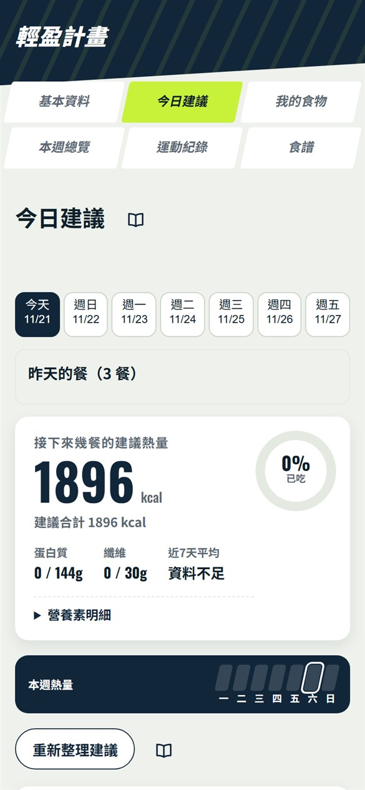
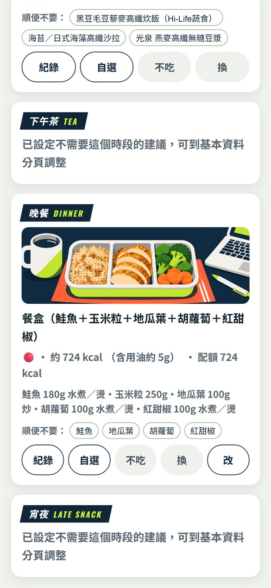
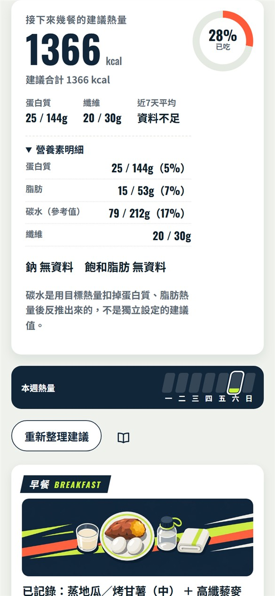
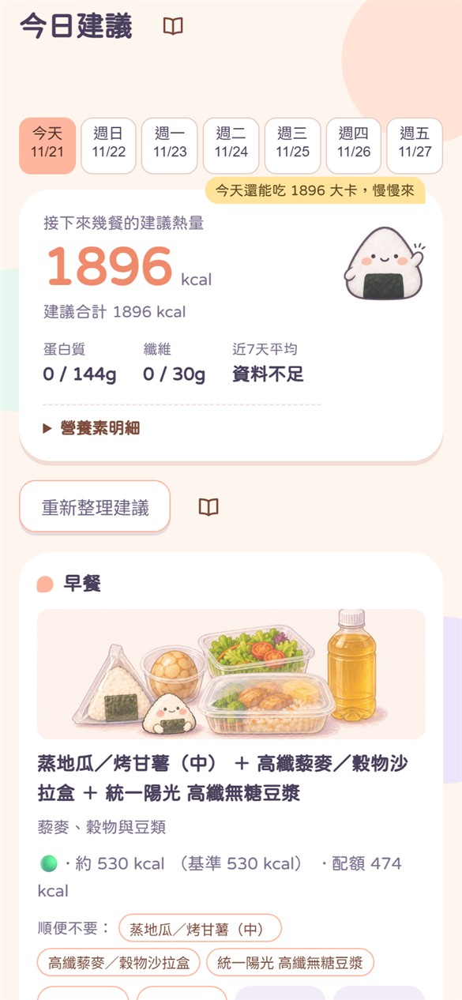
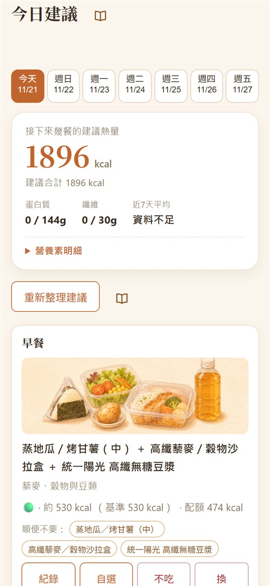
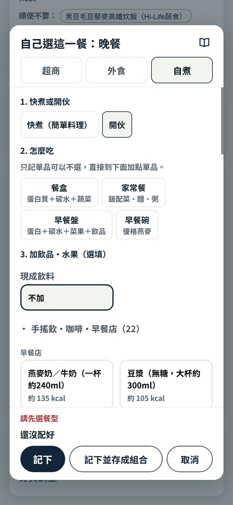

# 輕盈計畫 Lighten2

幫你把每天三餐排好的減脂飲食 App：依你的身高、體重、活動量算出熱量與蛋白質目標，每餐給一個吃得到的建議，超商、外食、自己煮都有。

**線上版**：<https://tongxiaooppo-boop.github.io/Lighten2/>（手機瀏覽器打開後可「加到主畫面」當 App 用）

## 畫面

| 今日建議（運動活力） | 建議卡片 | 營養素明細 |
|:---:|:---:|:---:|
|  |  |  |

| 療癒粉彩 | 經典暖色 | 自己選這一餐 |
|:---:|:---:|:---:|
|  |  |  |

## 功能

- **今日建議**：早餐、午餐、晚餐（可加下午茶、宵夜）各給一組建議，標出熱量與配額；不喜歡可以「換」或標「順便不要」。
- **三種吃法**：超商、外食（早餐店、便當、速食等）、自己煮（餐盒、家常合菜、早餐盤、早餐碗），卡片插圖會跟著餐點種類換。
- **自己選**：照實際吃的內容記錄，也可以存成常用組合下次一鍵帶入。
- **我的食物**：查營養、標不吃的食物與過敏原、新增自己的品項與食材。
- **本週總覽、運動紀錄、食譜**：補記過去幾天、記錄運動、家常菜作法。
- **三種外觀**：運動活力、療癒粉彩、經典暖色，在基本資料分頁切換。
- **資料只存在你的手機**（瀏覽器的 IndexedDB），不需要帳號；可匯出備份檔、再還原。

## 開發文件

- 規格：[docs/PRD.md](docs/PRD.md)；章程：[docs/CHARTER.md](docs/CHARTER.md)；決策紀錄：[docs/decisions.md](docs/decisions.md)
- 使用說明（App 內同一份）：[docs/使用說明.html](docs/使用說明.html)
- 架構審核紀錄：[collab/opus-review-log/](collab/opus-review-log/)
- 檢查工具：`node tools/check-engine.js`、`node tools/check-arch.js`、`node tools/smoke-browser.mjs`、`node tools/mobile-walkthrough.mjs`
- v1 舊文件：[docs/v1/](docs/v1/)；v1 最終程式碼在 git tag `v1-final`。這個 repo 沿用舊專案（原名 `lighten`）的完整 commit 歷史。

## 授權

[MIT](LICENSE)
